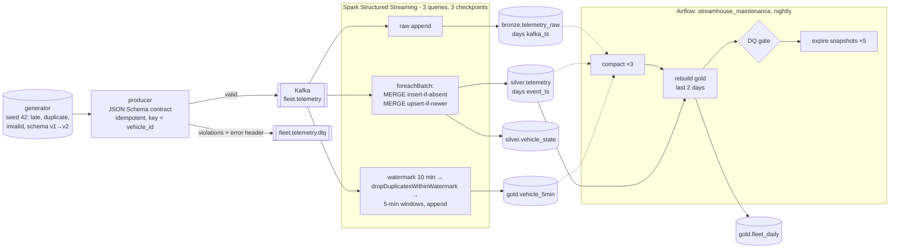

# streamhouse

A streaming lakehouse for fleet telematics. A producer validates vehicle pings against a JSON Schema contract and
publishes them to **Kafka**. Pings that break the contract go to a dead-letter topic. **Spark Structured Streaming**
writes three **Apache Iceberg** layers: raw **bronze**, deduplicated **silver** (`MERGE INTO`), and event-time windowed
**gold**. An **Airflow** DAG handles the batch side: compaction, a gold rebuild that recovers late data, data-quality gates
and snapshot expiry. **Terraform** defines the AWS deployment: S3, KMS, Glue, IAM, MSK Serverless and EMR Serverless.

Everything runs on a laptop without Docker. The tests use real local Spark and Iceberg, librdkafka's built-in mock
Kafka cluster, and moto's S3 server. The benchmark was run through a real Kafka 4.1 broker.



All tables are Iceberg format v2 with zstd Parquet. The warehouse is a local directory or `s3://` (MinIO, moto or AWS).
The catalog is Iceberg's JdbcCatalog on an embedded H2 file locally, or Glue in AWS.

## Quickstart

Requires [uv](https://docs.astral.sh/uv/) and **Java 11+** (Iceberg 1.10). If `JAVA_HOME` is unset, the code uses a
JDK unpacked in `.tools/jdk-17*`. That is how this project was built: Temurin 17 downloaded into the gitignored
`.tools/`, nothing installed globally. The first Spark start resolves the Iceberg, Kafka-source and H2 jars into
`.tools/ivy2`.

```bash
make install            # uv sync --all-groups (Python 3.11: runtime + dev + airflow)
make test               # ruff + 31 pytest tests (~95 s)
make bench              # end-to-end benchmark, file replay, no broker  -> reports/bench-files.json
make tf                 # terraform fmt -check + init -backend=false + validate

# with a broker (docker compose up -d kafka, or any Kafka on localhost:9092)
make bench-kafka        # -> reports/bench-kafka.json
uv run streamhouse produce --vehicles 30 --hours 3
uv run streamhouse stream --once          # drop --once for a long-running job (10 s trigger)
uv run streamhouse maintain {gold,dq,compact,expire}
```

`docker-compose.yml` runs Kafka (KRaft), MinIO and the app container. See [What was not verified](#what-was-not-verified).

## How it works

| Piece | Code | What it does |
|---|---|---|
| Contract | `contracts/telemetry.schema.json`, `contract.py` | A single JSON Schema (2020-12, `additionalProperties: false`, ranges, patterns) is used for both producer validation and the Spark schema. Fields carry `x-added-in`, so `spark_schema(version=1)` and `spark_schema(2)` come from the same file. |
| Generator | `generate.py` | Deterministic per seed. Pings are emitted in **arrival order** with ground-truth labels: 4% `late_minor` (1-5 min late, inside the watermark), 1% `late_major` (20-40 min, behind it), 3% `duplicate` resends, 0.5% `invalid`. Pings from the second half of the time range are `schema_version: 2` with a new `battery_temp_c` field. The data crosses midnight, so it spans two day partitions. |
| Producer | `producer.py` | `confluent-kafka` with `enable.idempotence`, `acks=all` and zstd compression. Messages are keyed by `vehicle_id`, so each vehicle's pings stay ordered in one partition. The `murmur2_random` partitioner places keys the same way Java clients do. Contract violations go to the DLQ topic with the reasons in an `error` header. |
| Bronze | `streaming.start` | Raw `value` plus Kafka topic, partition, offset and timestamp, appended unparsed. Hidden partitioning by `days(kafka_ts)`. |
| Silver | `streaming.write_silver` | `foreachBatch` materializes the micro-batch, then runs two MERGEs. **Insert-if-absent** on `event_id` (plus `event_ts`, so the target scan prunes to the batch's day partitions) makes resends and replayed batches no-ops. **Upsert-if-newer** into `vehicle_state` (`WHEN MATCHED AND s.event_ts > t.event_ts`) means a late ping can never overwrite newer state. Silver keeps late data however late it is. |
| Gold (stream) | `streaming.gold_windows` | 10-minute watermark, `dropDuplicatesWithinWatermark(event_id)`, then 5-minute tumbling windows per vehicle in append mode. A window is written once, after the watermark passes its end. Rows behind the watermark are dropped. |
| Gold (batch) | `maintenance.rebuild_gold_daily` | `INSERT OVERWRITE` from silver with dynamic partition overwrite. Only the days touched are replaced and reruns are idempotent. This rebuild counts the late events that the streaming windows dropped. |
| DQ gate | `maintenance.dq_checks` | Six SQL checks, each counting violating rows: duplicate event ids, null required fields, out-of-range speed, `vehicle_state` not holding the latest ping, gold daily not reconciling to the silver row count, and streaming gold **over**-counting any window (under-counting is expected; over-counting would be a bug). |
| Maintenance | `maintenance.compact`, `expire_snapshots` | `rewrite_data_files` (bin-pack to 128 MB targets) and `expire_snapshots` (default 7 days, keeping at least 5). |
| Orchestration | `dags/streamhouse_maintenance.py` | Airflow 3 TaskFlow DAG: `compact` (mapped over 3 tables) → `rebuild_gold` (the run's day and the day before) → `dq_checks` (`retries=0`) → `expire` (mapped over 5 tables). Expiry runs only after DQ passes, so a bad rebuild can still be rolled back with `rollback_to_snapshot`. |
| Infra | `terraform/` | Root module plus `modules/lakehouse`, described below. |

### Iceberg features, and where each one is exercised

| Feature | Where |
|---|---|
| Hidden partitioning (`days(event_ts)`) | `tables.py`. `test_hidden_day_partitioning` checks that rows land in the right day partition and that a plain `event_ts` filter is enough to query them. |
| Additive schema evolution | `tables.ensure_tables` compares the table with the contract and runs `ALTER TABLE ADD COLUMN` (a metadata-only change). In `test_additive_schema_evolution_and_time_travel`, v1 rows read `NULL` and v2 rows carry the value. |
| Time travel | `VERSION AS OF <snapshot>` reads with the snapshot's own schema, so the pre-evolution snapshot has no `battery_temp_c` column (tested). The benchmark also queries the first streaming snapshot. |
| MERGE INTO | Both silver MERGEs. Upsert ordering and replay safety are covered by `test_vehicle_state_upsert_is_order_independent_and_replay_safe`. |
| Compaction and snapshot expiry | `rewrite_data_files`, then `expire_snapshots` physically deletes the small files that only old snapshots still referenced (tested, and measured below). |
| Exactly-once streaming sink | Bronze and gold use Iceberg's streaming sink, which records the query id and epoch in each snapshot and skips epochs it already committed. Silver uses idempotent MERGEs. |

## Tests

31 tests, all run in CI. None needs Docker or a broker.

- **Streaming (real Spark).** `file_source` replays JSON-lines files with the same columns as the Kafka source, one file per
  micro-batch. That lets the tests control batch boundaries, and therefore the watermark, exactly.
  - `test_watermark_dedup_and_restart_from_checkpoint`: a late event inside the watermark is counted in its window; one
    behind the watermark is dropped from gold but kept in silver; a resend is not double-counted; garbage JSON reaches bronze
    but not silver; a restart from the checkpoint re-reads nothing (bronze holds exactly 9 of 9 raw lines).
  - `test_crash_between_merges_replays_to_the_same_state`: the state MERGE is made to fail after silver has committed. Spark
    replays the batch on restart and the end state matches a clean run, with no duplicates.
- **Iceberg (real Spark):** MERGE semantics, schema evolution and time travel, hidden partitioning, compaction then
  expiry, gold rebuild idempotence and partial (per-day) rebuilds, and the DQ gate catching an injected duplicate.
- **Kafka producer.** The real `confluent-kafka` client runs against librdkafka's in-process mock cluster
  (`test.mock.num.brokers=3`). The test consumes everything back and checks valid vs DLQ routing, the error headers, and that
  every key maps to one partition. That partition must equal `murmur2(key) % n` as computed by a Python port of Kafka's Java
  `Utils.murmur2`, itself checked against the vectors in Kafka's `UtilsTest`.
- **S3.** The same streaming, gold, DQ and compaction flow runs with `ICEBERG_WAREHOUSE=s3://lake/warehouse` against moto's S3
  server through Iceberg `S3FileIO`. The test then lists the bucket to confirm day-partitioned Parquet files and metadata JSON.
- **Airflow.** The DAG imports with no errors and its dependency order is asserted.
- **Generator and contract:** determinism, every messy case present, and each invalid payload failing the contract (and only
  those).

## Measured results

All numbers come from `streamhouse bench` (`reports/bench-*.json`) with seed 42 on an Apple M3 Pro (11 cores, 18 GB).
Spark ran in `local[4]`. Bench settings were 100 vehicles × 4 h of pings every 30 s, in micro-batches of 500 events.

**Workload:** 49,402 arrivals. These are 47,756 unique valid events, plus 1,402 duplicate resends, 244 invalid payloads,
1,840 `late_minor` and 445 `late_major`.

| | Through Kafka 4.1.2 (6 partitions) | File replay |
|---|---|---|
| Producer: contract check + publish + all acks | 49,402 msgs in 2.19 s (22.6k msg/s) | n/a |
| Routed to DLQ | 244 / 244 invalid | 244 / 244 |
| Streaming: 3 queries, 99 micro-batches | 69.3 s → **710 events/s** | 71.3 s → 690 events/s |
| Silver rows vs ground truth | **47,756 / 47,756**: 0 missing, 0 unexpected | same |
| Duplicates removed | **1,402 / 1,402** | same |
| v2 rows with `battery_temp_c` | 23,890 / 23,890 | same |
| `vehicle_state` wrong latest ping | 0 of 100 vehicles | same |
| Streaming gold: events dropped as late | 422. This is **exactly the 422 `late_major` events** in the emitted windows. 0 other events lost, 0 windows over-counted | same |
| Nightly gold rebuild vs ground truth | 47,756 pings, **0 / 200 (day, vehicle) rows mismatched** | same |
| DQ gate | 6 / 6 checks pass | same |
| Compaction: silver / gold 5-min / bronze data files | 115 → 2, 45 → 2, 99 → 1 | 114 → 2, 45 → 2, 99 → 1 |
| Snapshot expiry, silver (keep last 1) | 115 small files physically deleted | 114 |
| Time travel | first silver snapshot: 488 rows; current: 47,756 | 490 / 47,756 |

**Throughput depends heavily on micro-batch size.** Each micro-batch commits to three tables and runs two MERGEs, so
fixed per-batch cost dominates at 500 events per batch. In an earlier file-replay run with `--batch-size 5000`
(10 micro-batches), the same workload streamed in 10.1 s, or **4,891 events/s**. But each batch then covered about 24 minutes
of event time, and the streaming watermark trailed far enough behind that only **12 of the 422** `late_major` events were
dropped. The results stayed exact (silver complete, nothing over-counted, the rebuild matched ground truth). What changed is
how many very-late events the real-time gold table included. In other words, the "late" cutoff of a watermark is measured in
micro-batches as much as in minutes.

These are local single-machine numbers for a correctness-heavy job. They are not a cluster throughput claim.

## Design decisions and trade-offs

- **Silver is complete; real-time gold is fast but can miss very late data.** Silver never drops data for lateness, and
  `MERGE` handles dedup across any time range. The streaming windows have to finalize at some point (append mode, a 10-min
  watermark), so they drop events behind it. The nightly rebuild from silver makes gold exact. The DQ gate checks both
  directions: daily gold must reconcile exactly, and the 5-minute gold may under-count but must never over-count.
- **A watermark subtlety, found by a failing test.** Gold chains two stateful operators (dedup, then aggregation). For
  chained operators, Spark 3.5 filters late rows against the *previous* micro-batch's watermark. An event can therefore
  arrive further behind than the configured 10 minutes and still be counted. `tests/test_streaming.py` pins this behaviour
  with exact batch boundaries.
- **Exactly-once comes from idempotence, not transactions.** `foreachBatch` is at-least-once. The two MERGEs are separate
  Iceberg commits, but each is idempotent (insert-if-absent, update-if-newer), so replaying a batch after a crash converges to
  the same state. The crash test proves this.
- **The micro-batch is materialized (`localCheckpoint`) before the MERGEs.** Without it, the state MERGE failed in Iceberg's
  runtime filtering (`Couldn't find vehicle_id#…`). Materializing also means both MERGEs read identical rows.
- **Three queries, three checkpoints.** Bronze, silver and gold fail, lag and replay independently. The cost is that the
  topic is read three times.
- **Catalog: H2 locally, Glue in AWS.** SQLite was tried first and failed. Each streaming query runs in a cloned SparkSession
  with its own catalog connection pool, and concurrent commits hit `SQLITE_BUSY_SNAPSHOT`. Embedded H2 (MVCC, `AUTO_SERVER` for
  the CLI and Airflow processes) works. Catalog caching is disabled, because a cached table kept serving its first snapshot and
  hid the streaming queries' commits. The Hadoop catalog was rejected because it relies on atomic rename, which S3 doesn't provide.
- **Copy-on-write MERGE.** `vehicle_state` is small, so rewriting it on every batch is cheap. For a large, update-heavy table,
  `write.merge.mode=merge-on-read` (delete files, with compaction reconciling them) would be the switch.
- **Producer-side validation, consumer-side backstop.** The contract is enforced before Kafka. Spark still filters rows
  `from_json` can't parse, and bronze keeps every raw line for replay and forensics.

## Terraform (AWS deployment shape)

`terraform/modules/lakehouse` contains:
- **S3 lake bucket:** versioned, SSE-KMS with a customer-managed key (rotation on, bucket keys on), public access blocked,
  `BucketOwnerEnforced`, and a TLS-only bucket policy. Lifecycle rules abort incomplete multipart uploads after 7 days, expire
  noncurrent versions after 14 days (a safety net under Iceberg's own snapshot expiry), and move bronze data to `STANDARD_IA`
  after 30 days.
- **Glue databases** `bronze`, `silver`, `gold`, matching the Spark namespaces. Run with `ICEBERG_CATALOG_URI=glue`.
- **MSK Serverless** with IAM auth only, so there are no SCRAM secrets to rotate.
- **EMR Serverless** Spark application (EMR 7.x = Spark 3.5) with auto-stop.
- **Least-privilege job role** (assumable only by EMR Serverless from this account). It can list and read/write only the
  `warehouse/`, `checkpoints/` and `logs/` prefixes, use only the lake KMS key, act on only the three Glue databases, read only
  `fleet.telemetry*` topics, and use only `spark-kafka-source-*` consumer groups.

`make tf` passes `terraform fmt -check` and `terraform validate` (Terraform 1.17.1, AWS provider 6.72). **Nothing was
applied**, and no AWS account was used. On MSK Serverless the Spark Kafka source also needs the `aws-msk-iam-auth` jar and
SASL/IAM options. That wiring is not in the code. To use Confluent Cloud instead of MSK, drop the MSK resources and
statements and pass SASL/PLAIN credentials from Secrets Manager.

## What was not verified

- **`docker compose`**: the Docker daemon was off on the build machine, so `docker-compose.yml` and the `Dockerfile` have
  never been run. The same topology was run natively instead: a native Kafka 4.1.2 broker in KRaft mode for the benchmark and
  the CLI, and moto's S3 server in place of MinIO in the tests. The MinIO image tag is pinned to a 2025 release because MinIO
  stopped publishing community images.
- **AWS**: the Terraform plans validate but were never applied. The Glue catalog path (`ICEBERG_CATALOG_URI=glue`) and MSK
  IAM auth have not been exercised.
- **Airflow scheduler**: not run. The DAG import test runs in CI. Separately, `airflow dags test streamhouse_maintenance
  2026-11-03` ran all 10 task instances to success locally against a small lake. In that run every task shared one in-process
  Spark session. Under a real executor, each task would start its own Spark session (or submit to EMR Serverless).
- **Scale**: single machine, `local[4]`, about 50k events. No cluster runs and no long-running soak test.
- The data is synthetic. Real telematics has clock skew, GPS jumps and device firmware quirks that this generator doesn't model.

## Layout

```
contracts/      telemetry.schema.json (the data contract)
src/streamhouse config, contract, generate, producer, spark, tables, streaming, maintenance, bench, cli
dags/           Airflow DAG (nightly maintenance)
terraform/      root module + modules/lakehouse (S3, KMS, Glue, MSK Serverless, EMR Serverless, IAM)
tests/          pytest suite
reports/        benchmark output (bench-kafka.json, bench-files.json)
```

MIT licensed.
